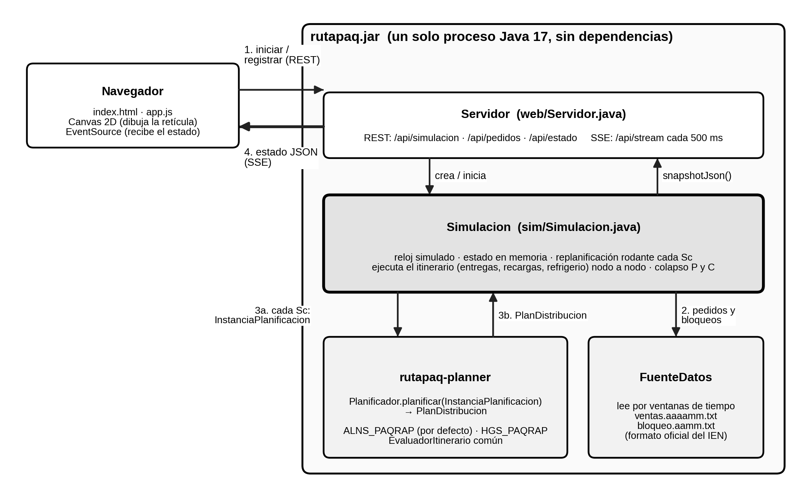

# RUTAPAQ rutapaqS13v1: servidor, operación día a día, simulación y visualizador con rutapaq-planner (ALNS y GA)

Un solo proceso Java 17 **sin dependencias en ejecución**. Contiene el código de
**rutapaq-planner v2.0** (`pe.pucp.paqrap.planner`: ALNS_PAQRAP, HGS_PAQRAP, EvaluadorItinerario y
el banco del IEN) y, alrededor de él, la simulación y el visualizador web (`pe.pucp.paqrap.app`).

Alcance de la v03: sobre la **simulación de 5 días** de la v02 se agregan las **averías** de las unidades
(tipos 1, 2 y 3), con registro manual desde el visualizador, trasvase de paquetes,
traslado al almacén central y replanificación inmediata. El servidor ya aplica las averías en los tres
escenarios.

Alcance de la v04: la **simulación hasta el colapso** en el visualizador. La operación día a día sigue pendiente
en la interfaz.

Alcance de la v0.4.1: averías solo manuales (indicación del profesor) y ajustes de la interfaz pedidos en la
revisión (tiempos de la barra superior, stock de los almacenes en %, color por tipo de avería y menú en español).

Alcance de la v0.5.0: revisión de la v0.4.1 (rutapaqS12v1) frente a la situación auténtica, la P&R y los ítems de
evaluación (equipo de 4: se cumplen los ítems Sí3 y Sí4). Las decisiones del equipo están en el documento
"Historial de cambios y decisiones" del proyecto.

Alcance de rutapaqS13v1: el escenario de **operaciones día a día** (menú **Tiempo real**), con registro de pedidos y
averías en línea y cierre de operaciones con el reporte de la última planificación estable (G09). Parte de
rutapaqS12v3 y conserva el diseño del visualizador.

## Cambios de rutapaqS13v1 respecto de rutapaqS12v3

| # | Cambio | Rúbrica / P&R | Dónde |
|---|---|---|---|
| 1 | **Operación día a día independiente del Simulador de rutas.** Arranca sola con el servidor y corre en paralelo: iniciar, detener o reemplazar un 5 Días o un Colapso no la afecta. Cada navegador elige qué vista mira (Tiempo real o Simulador de rutas) sin afectar a los demás. | Situación auténtica (3 escenarios); C05, C06, G06 | `Servidor`, `app.js` |
| 2 | **Reloj = fecha y hora actual de Lima** (`escenario.diario.zona=America/Lima`), con K = 1, aunque el servidor o la VM estén en UTC. Si la PC se suspende, al volver la operación se pone al día. | C12 a C16 | `Simulacion` |
| 3 | **Sin archivos de ventas**: los pedidos solo llegan por el registro en línea. Los **bloqueos** y el **mantenimiento** sí se leen de los archivos de `datos/`, con la fecha real (los bloqueos son planificados con antelación). | Necesidad (i); B16; P&R 7 y 19 | `FuenteDatos`, `Simulacion` |
| 4 | **Planificación programada cada `escenario.diario.saMinutos` (5 min)**, alineada al reloj (17:00, 17:05…). Como K = 1, Sa = Sc. Además, **registrar un pedido o una avería replanifica de inmediato**; si el planificador está trabajando, queda una sola replanificación pendiente que se lanza apenas termina (nunca hay dos a la vez). Las replanificaciones extra no corren la programada. | A17 a A19; planificación programada | `Simulacion.siguienteCiclo`, `registrarPedido` |
| 5 | **Registrar pedido** (botón de la barra superior en Tiempo real): x, y (también con un clic en el mapa), cantidad, plazo (4, 8, 12, 18 o 36 h) y cliente. El plazo se cuenta desde el momento del registro. Al registrarlo se selecciona en el mapa. | Necesidad (i); B16 | `index.html`, `app.js`, `POST /api/pedidos` |
| 6 | **Registro histórico de pedidos**: cada pedido registrado se agrega a `datos/registrados/ventas.aaaamm.txt`, con el formato de los archivos del profesor. Está en una subcarpeta para no mezclarse con los datos del profesor. Es solo un registro: si el servidor se reinicia, la operación en curso no se recupera. | B13 | `RegistroPedidos` |
| 7 | **Averías en tiempo real**: el mismo registro manual de siempre, aplicado a la vista que se está mirando. | B07 a B09; D10 a D13 | `Servidor`, `app.js` |
| 8 | **Sin colapso ni pausa** en el día a día: un pedido vencido se cuenta como vencido y se sigue entregando (plazo de 36 h, prioridad más baja), y la operación continúa. | Decisión del equipo | `Simulacion` |
| 9 | **Cerrar operaciones** (con confirmación): termina la operación para todos los navegadores y muestra el reporte de la última planificación estable con sus indicadores, CSV e impresión. **Reabrir operaciones** abre una nueva desde la hora actual, con la flota en el almacén central y la configuración guardada. | G09 | `Simulacion.cerrarOperaciones`, `Servidor`, `app.js` |
| 10 | **Barra superior en Tiempo real**: fecha y hora actual y tiempo de operación (sin fecha de inicio, sin selector 5 Días / Colapso y sin Iniciar/Detener). El menú "Tiempo real" ya está habilitado. | C12 a C16 | `index.html`, `app.js`, `estilos.css` |
| 11 | **Mantenimiento preventivo de 48 h** para los tres tipos de unidad (respuesta del profesor a la P&R 19 del 03/11/2026). | P&R 19 | `PlanMantenimiento`, `config.properties` |
| 12 | **Pantalla Configuración**: nueva sección "Operación día a día" (planificar cada N minutos). Lo que antes regía "al iniciar la próxima simulación" ahora también rige al reabrir las operaciones; velocidad y reglas de averías se aplican a la simulación y a la operación en curso. | B04, B07 a B09 | `CatalogoConfiguracion`, `Servidor` |
| 13 | **Lo que llega a cada almacén** (pestaña Almacenes): nueva sección "En camino al almacén" con las unidades que van a recargar allí, su hora de llegada, los paquetes que traen y los que recargarán. "En tránsito" pasa a llamarse "En tránsito (salieron de aquí)". | E20 | `Simulacion.snapshotJson` (campo `llegan`), `app.js` |
| 14 | **Bloqueos planificados en el planificador**: como los bloqueos se conocen de antemano (P&R 7), cada plan considera los vigentes y además los que empiezan dentro de `planificador.anticipacionBloqueosHoras` (1 h por defecto; 0 = solo los vigentes, como antes). Las unidades siguen esos mismos caminos, así que no entran a una calle que se cerrará en ese lapso. Si con los bloqueos futuros algún almacén, unidad o destino quedara sin camino, ese plan usa solo los vigentes. En el mapa se siguen dibujando solo los vigentes y nadie atraviesa un nodo bloqueado. El resumen final muestra la anticipación usada. | G07; P&R 7 | `Simulacion` (`mapaPrevisto`, `mapaParaPlanificar`, `camino`), `config.properties` |

Endpoints nuevos o cambiados:

| Endpoint | Qué hace |
|---|---|
| `GET /api/stream?vista=operacion`, `GET /api/estado?vista=operacion` | Estado de la operación día a día (sin `vista`, el del simulador) |
| `POST /api/pedidos?x=&y=&cantidad=&plazo=&cliente=` | Registra un pedido en la operación día a día (con `vista=simulacion`, en la simulación en curso) |
| `POST /api/averias?vista=operacion&unidad=&tipo=`, `GET /api/averias?vista=operacion` | Averías de la operación día a día |
| `GET /api/plan?vista=operacion`, `GET /api/plan.csv?vista=operacion` | Última planificación estable de la operación día a día |
| `POST /api/operacion/cerrar`, `POST /api/operacion/reabrir` | Cierra la operación (G09) o abre una nueva desde la hora actual |
| `POST /api/simulacion?escenario=DIA_A_DIA` | Ya no se acepta: la operación día a día está aparte |

Claves nuevas en `config.properties`: `escenario.diario.zona`, `escenario.diario.saMinutos` y
`planificador.anticipacionBloqueosHoras`; `mantenimiento.horas.*` pasa a 48. Al desplegar, copiar también el `config.properties` nuevo.

Resultado de referencia (5 días desde el 01/01/2026, sin interfaz): **76 recibidos, 75 entregados (100 % a tiempo),
S/ 10 300**. Antes era 74 entregados y S/ 10 184: el mantenimiento de 48 h lleva a 75 y S/ 10 252, y la anticipación de
bloqueos de 1 h a S/ 10 300 (desvíos un poco más largos). Con `planificador.anticipacionBloqueosHoras=0` da
exactamente S/ 10 252.

Con más demanda, la anticipación de bloqueos ayuda (medido sin interfaz, en el entorno de pruebas; el ALNS se corta
por tiempo, así que hay variación entre corridas): 5 días desde el 01/06/2027, 90,0 % a tiempo y 171 vencidos frente a
89,3 % y 182 sin anticipación; colapso desde el 01/03/2027, Tc = 146,7 h frente a 107,6 h. Ta máximo sin cambios
(~2 s, el tope de cómputo).

Limitación conocida: la capacidad, la velocidad y el costo de cada tipo de unidad son comunes a la operación y al
simulador. Si se cambia la capacidad o el costo en Configuración y luego se inicia una simulación, el cambio también
llega a la operación en curso. Por eso conviene cambiar la flota solo antes de una presentación, no durante
(P&R 18).

## Cambios de la v0.5.0 respecto de la v0.4.1

| # | Cambio | Rúbrica / P&R | Dónde |
|---|---|---|---|
| 1 | **Flota en una sola fuente configurable**: capacidad, velocidad y costo por km de cada tipo se leen de las claves `flota.auto.*`, `flota.moto.*`, `flota.bici.*`. `TipoUnidad` (simulación) ya no tiene valores propios: los toma de `TipoVehiculo` (planificador), así nunca difieren. Prepara el cambio de velocidad en caliente (pendiente). | B04; P&R 6, 15 y 16 | `planner/model/TipoVehiculo`, `app/modelo/TipoUnidad`, `Config`, `Configuracion`, `planner.properties` |
| 2 | **Duración del mantenimiento por tipo** (`mantenimiento.horas.auto`, `.moto`, `.bici`), por ahora 24 h para todos como en el archivo del profesor. Borrador de la P&R aún no confirmado: bicicleta hasta las 07:00 (7 h), moto 24 h, auto 48 h. **Desde rutapaqS13v1: 48 h para todos** (P&R 19, 03/11/2026). | P&R 19 | `app/datos/PlanMantenimiento`, `Simulacion` |
| 3 | **Recarga configurable** (`recarga.soloLoNecesario`, `false` por defecto): la unidad se sigue llenando hasta su capacidad (decisión del equipo tras comparar ambas formas: cargar solo lo necesario costó 2–9 % más y dio más vencidos con demanda alta). | P&R 20 | `Simulacion` |
| 4 | **Semáforo + vacío**: nuevo nivel `VACIO` (gris). Regla: el rojo siempre es peligro. Almacenes: verde bastante stock, ámbar poco, rojo muy poco, vacío 0. La carga de una unidad usa el mismo criterio (antes una unidad llena era roja). | B06, C21, C27, E03, E19 | `Indicadores`, `config.properties` |
| 5 | **Indicadores globales** en el panel izquierdo: ocupación de la flota en servicio y stock de los almacenes intermedios en conjunto, con semáforo + vacío. | G01 a G04 | `index.html`, `app.js`, `snapshotJson` |
| 6 | **Filtros globales del mapa** en el panel derecho: por tipo de unidad, por semáforo + vacío de la carga de las unidades y del stock de los almacenes. | D05, D06, D07 | `index.html`, `app.js` |
| 7 | **Pestaña Unidades**: todas las unidades con carga (número, % y semáforo + vacío), destino inmediato (llega / sale, en minutos), origen (almacén y hora de salida); orden por ocupación, hora de salida o de llegada (asc./desc.); búsqueda por minutos al destino o al origen, a la llegada o a la salida; al elegir una se ven sus envíos y productos. Enlace bidireccional con el mapa. | E02 a E07, E13 a E15, F01 | `app.js`, horarios en `Simulacion.horarios()` |
| 8 | **Pestaña Almacenes**: stock con semáforo + vacío, paquetes a bordo, envíos en tránsito, que salen en las próximas 4 h y entregados en las últimas 4 h (`panel.ventanaHoras`). Enlace bidireccional con el mapa. | E18 a E22, F05 | `app.js`, `snapshotJson`, historial `entregasRecientes` |
| 9 | **Envíos y productos**: cada pedido muestra sus envíos (unidad, cantidad, identificadores de producto `P12-1 a P12-5`, almacén y hora de salida, hora de llegada; varias unidades si se reparte). Elegir un envío resalta solo la ruta de esos productos; elegir el pedido, las de todos. | E31, F02, F03 | `Simulacion.productos()`, `app.js` |
| 10 | **Reporte de la última planificación estable** al terminar los 5 días o al colapsar: itinerario de cada unidad con horas estimadas, productos, descarga en CSV e impresión. `GET /api/plan` y `GET /api/plan.csv`. | G08, G10 | `Simulacion.guardarPlan()/planJson()/planCsv()`, `Servidor`, `app.js` |
| 11 | **Mapa**: el ícono de la unidad gira según la dirección en que avanza (derecha, izquierda, arriba, abajo); barra de carga con semáforo + vacío bajo el ícono (el color del ícono sigue siendo su estado); zoom continuo con la rueda y los botones, sin saltos; centrado animado. | C08, C27, C30 | `app.js` |
| 12 | **Interfaz**: paneles contraídos al inicio; "Tablero" pasa a "Panel de Control"; las leyendas del semáforo (pedidos, carga, flota, almacenes) se arman con los umbrales configurados (`/api/config` → `semaforo`). | E01, C07, RNF d | `index.html`, `app.js`, `Servidor` |
| 13 | **Planificador en segundo plano** (servidor). El ciclo se divide en preparar (con el estado vigente), ejecutar (el ALNS en el hilo "planificador", con una copia del mapa) y aplicar. Mientras el ALNS trabaja, la simulación sigue avanzando y publicando: antes el estado se bloqueaba hasta 2 s en cada ciclo y las unidades saltaban; ahora la peor respuesta de `/api/estado` medida con junio 2028 fue 61 ms. El plan se calcula para el instante en que llegará (t + Ta estimado × K). Al aplicarlo, una unidad que se averió o entró a mantenimiento mientras tanto no recibe su ruta, y a ningún pedido se le asigna más de lo que le falta. Las pruebas y `probar` siguen en modo síncrono (mismos resultados que antes). | C29, G06 | `Simulacion.preparar()/ejecutar()/aplicar()`, `MapaReticula.copia()` |
| 14 | **Criterio C del colapso con el Sa real**: Sa = Sc / K (15 s en 5 días, 6 s en colapso). Colapsa si una ejecución tarda Sa o más, o si toca la siguiente y la anterior aún no termina. `ien.saSegundos` queda solo para el banco del IEN. El reporte final muestra Ta, Sc y Sa. | A17 a A19 | `Simulacion` (`saMs`), `app.js` |
| 15 | El refrigerio nunca empieza antes de su ventana (1 h después del cambio de turno): si la unidad llega antes de lo estimado, espera. | Situación auténtica | `Simulacion.inicioRefrigerio()` |
| 16 | Al elegir una unidad o un almacén en el mapa se abre el panel derecho (los paneles empiezan contraídos) en su pestaña, con la fila resaltada. | F01, F05 | `app.js` |
| 17 | **Pantalla Configuración** (menú izquierdo): almacenes (ubicación y capacidad), flota por tipo (cantidad, capacidad, velocidad, costo), averías tipo 1, 2 y 3 y trasvase, mantenimiento por tipo y rangos del semáforo. Todos los parámetros viven en `config.properties`; la pantalla los valida, los guarda allí (solo las líneas que cambian, conservando los comentarios) y los aplica: semáforo y averías **ahora**, velocidad **en el siguiente ciclo de planificación** (P&R 15 y 16: velocidad en caliente por tipo), y almacenes, cantidad, capacidad, costo y mantenimiento **al iniciar la próxima simulación** (P&R 9). Pide confirmación porque afecta a todos los navegadores, que se actualizan solos. Botón para restaurar los valores de fábrica. `GET/POST /api/configuracion`, `POST /api/configuracion/restaurar`. | B02, B04, B06, B07, B08, B09 | `app/CatalogoConfiguracion`, `Config.guardar()`, `Servidor`, `index.html`, `app.js` |
| 18 | 9 pruebas nuevas: flota configurable, mantenimiento por tipo, semáforo con vacío, recarga, envíos/entregas/último plan, planificador en segundo plano, criterio C con el Sa real, guardado y aplicación de la configuración, y su validación. | | `src/test/java/.../app/sim/V05Test.java` |
| 19 | `compilar-sin-maven.cmd` para compilar en Windows sin Maven. | | |
| 20 | **Mapa configurable**: `ien.mapaAnchoKm` e `ien.mapaAltoKm` (70 x 50 por defecto) pasan a `config.properties` y a la pantalla Configuración (sección "Mapa de la ciudad", se aplica al iniciar la próxima simulación). El visualizador ya no tiene 70 x 50 fijo: dibuja el mapa de la simulación en curso (`mapa` en el estado) o, sin simulación, el configurado (`/api/config`). El registro de pedidos valida contra ese mapa, los bloqueos ya no dependen de una retícula fija y la simulación ignora los nodos de bloqueo que quedan fuera; un almacén fuera del mapa se rechaza al guardar y al iniciar, con un mensaje claro. | B01; P&R 4 | `config.properties`, `CatalogoConfiguracion`, `Servidor`, `Simulacion`, `Formato`, `app.js` |
| 21 | **Fecha de inicio sincronizada**: el campo de fecha y hora muestra el inicio de la simulación en curso al abrir la página (otra pestaña, incógnito u otro dispositivo) y se actualiza cuando otro navegador inicia una nueva, igual que el selector 5 Días / Colapso. | C02, C05, G06 | `app.js` |
| 22 | Comentarios de `config.properties` y `Config` actualizados: el archivo junto al .jar es el único lugar que se edita; `planner.properties` y la copia empaquetada son los valores de fábrica. | | `config.properties`, `Config` |

Verificación: las 49 pruebas pasan (38 de antes, 9 nuevas y 2 del mapa configurable). Con los valores por defecto, los 5 días desde el
01/01/2026 sin interfaz dan lo mismo que antes (76 pedidos recibidos, 74 entregados, S/ 10 184). En el servidor,
con junio 2028, el reloj simulado avanza parejo (K ≈ 240) y el estado responde en milisegundos aunque cada ejecución
del ALNS dure 2 s. Recorrido en el navegador a 1366×768 y 1920×1080, tema claro y oscuro: pestañas, filtros,
indicadores, envíos con productos, enlace mapa ↔ listas, reporte final de 5 días y de colapso, CSV.

Al desplegar en la VM, copiar también el `config.properties` nuevo: `semaforo.carga.*` cambió de sentido (antes una
unidad llena era roja; ahora verde) y hay claves nuevas.

## Cambios de la v0.4.1 respecto de la v04

Une la v04 (simulación hasta el colapso y correcciones) con los ajustes hechos en paralelo sobre la v03:

| # | Cambio | Dónde |
|---|---|---|
| 1 | Por indicación del profesor, las averías **solo se ingresan de forma manual** desde el visualizador (botón **Registrar avería**). Se quitan la lectura de `datos/averias.aaaamm.txt`, los 36 archivos de prueba, el comando `generar-averias` y la clave `averia.archivo.habilitado`. | `Simulacion`, `ReglasAveria`, `app/datos`, `App`, `config.properties`, `datos/` |
| 2 | Mapa: el distintivo y el halo de una unidad averiada usan **un color por tipo** (1 ámbar, 2 naranja, 3 rojo), igual que la pestaña Averías. | `app.js` (`dibujarAveriada`), leyenda |
| 3 | Barra superior: los **4 tiempos con su etiqueta**, en 2 filas: fecha y hora de simulación y duración de simulación (tiempo simulado transcurrido, nuevo); hoy (fecha y hora actual) y tiempo real transcurrido. Todos con segundos (Eval-4D C12 a C16; P&R hoja Guía, ítems 35 a 39). Antes la hora actual se ocultaba en pantallas de menos de 1500 px y en el celular; ahora los 4 tiempos se ven en cualquier ancho: en pantallas medianas se usan etiquetas cortas y se compactan los demás elementos (menú lateral, textos de los botones, indicadores y estado), y si aun así no caben, la barra pasa a 2 filas en vez de desbordarse. | `index.html`, `estilos.css`, `app.js` (`actualizarReloj`) |
| 4 | Menú lateral: "Dashboard" pasa a **"Tablero"**, para que toda la interfaz esté en español. | `index.html` |
| 5 | Inventario de almacenes: los intermedios muestran su **stock en %** de la capacidad máxima (panel, etiqueta del mapa, tooltip y detalle; al pasar el mouse, por ejemplo "250 de 1000 paquetes"). El semáforo pasa a medirse sobre el stock (`semaforo.almacen.verde=30`, `semaforo.almacen.ambar=10`: verde desde 30 %, ámbar desde 10 %, rojo por debajo), que equivale a los umbrales anteriores de consumo (70 % y 90 %). El almacén central se muestra con su ícono y sin dato, porque tiene abastecimiento permanente. | `Simulacion.snapshotJson()`, `Servidor` (`/api/config`), `index.html`, `estilos.css`, `app.js`, `config.properties` |
| 6 | Pruebas: se quitan las 2 del archivo de averías y se agrega una que verifica que un archivo en `datos/` ya no genera averías y que el registro manual sigue funcionando. | `AveriasTest` |
| 7 | Colapso: como las averías ya no se leen de archivo, se quita la clave `averia.archivo.colapso` de la v04 y su prueba pasa a verificar que en el colapso el archivo no genera averías y que el registro desde el visualizador funciona. | `Simulacion`, `config.properties`, `ColapsoTest` |

Verificación: las 38 pruebas pasan (15 del planificador, 16 de averías y trasvase, 3 del colapso y 4 de las
correcciones). Sin averías registradas, los 5 días desde el 01/01/2026 dan lo mismo que la v02, la v03 y la v04
(76 pedidos recibidos, 74 entregados, S/ 10 184). Colapso desde el 01/03/2027 sin interfaz: criterio P a las 143,7 h.
En el navegador: colapso forzado (reporte, alerta fija, etiqueta Colapso y mapa centrado en el pedido), simulación de
5 días completa con su resumen, registro de averías y trasvase, inventario en %, y la barra superior en anchos de
360 a 1920 px.

## Cambios de la v04 respecto de la v03: simulación hasta el colapso

Es la misma pantalla del Simulador de Rutas: en la barra superior se elige **Colapso** en lugar de **5 Días**
(documento de GUI, sección 4.3 y tabla 5).

| # | Cambio | Dónde |
|---|---|---|
| 1 | Selector **5 Días / Colapso** de la barra superior habilitado; **Iniciar** arranca el modo elegido. El selector sigue a la simulación en curso cuando aparece una nueva (iniciada en este u otro dispositivo). | `resources/web/` |
| 2 | En modo Colapso la tarjeta de la línea de tiempo D1–D5 desaparece (no hay duración definida); el reloj simulado y el tiempo real se mantienen. Pausar, reanudar y registrar averías funcionan igual que en los 5 días. | `resources/web/` |
| 3 | **Colapso**: cuando un pedido llega a su límite sin ser entregado (criterio P) o cuando una ejecución del planificador tarda `ien.saSegundos` o más (criterio C), la simulación se detiene. Se guarda el **reporte del colapso** tal como estaba en ese instante: criterio, fecha y hora simulada, Tc, pedido involucrado (cliente, ubicación, cantidad y entregado, plazo, registro, límite y unidad que lo llevaba) y estado de la flota (en ruta, disponibles, en mantenimiento y averiadas por tipo). | `Simulacion.colapso()`, campos `colapso` y `tipoFin` del estado |
| 4 | Al colapsar, la etiqueta de estado muestra **Colapso** en rojo, aparece una **alerta roja que no se cierra sola** (con *Ver reporte*), se abre el reporte con los indicadores acumulados y el mapa queda centrado en el pedido involucrado. | `resources/web/` |
| 5 | **Fin sin colapso**: si se acaban los datos de ventas de la carpeta y ya se entregó todo lo pendiente, termina con "Sin colapso…" y el resumen de indicadores. Si un pedido vence antes, eso ya es colapso. | `Simulacion.paso()`, `FuenteDatos.finDeVentas()` |
| 6 | (Retirado en la v0.4.1, donde las averías ya no se leen de archivo) Las averías programadas del archivo (`averias.aaaamm.txt`, de prueba, generadas por el equipo) **no se usan en el colapso**; se vuelven a activar con `averia.archivo.colapso=true`. En los 5 días siguen como antes. Las averías registradas desde el visualizador funcionan en ambos. | `Simulacion`, `config.properties` |
| 7 | 3 pruebas nuevas: reporte del colapso con el pedido y la flota, fin sin colapso al acabarse los datos, y averías del archivo solo en el colapso si se configura. | `src/test/java/.../app/sim/ColapsoTest.java` |

Velocidad: `escenario.colapso.factor` (600 por defecto: 1 día simulado dura unos 2,4 minutos reales); se fija antes
de iniciar y no se cambia desde la pantalla. El instante del colapso (Tc) puede variar entre corridas con los
mismos datos, porque el ALNS se corta por tiempo (ver *Reproducibilidad* en la v03).

Verificación: las 39 pruebas pasan. Recorrido en el navegador: colapso desde el 01/03/2027 (reporte, alerta fija y
mapa centrado en el pedido), simulación de 5 días con su resumen como antes, y fin sin colapso con datos solo de
enero de 2026.

## Cambios de la v03 respecto de la v02: averías

| # | Cambio | Dónde |
|---|---|---|
| 1 | Registro de averías desde el visualizador: botón **Registrar avería** en el detalle de la unidad y en la pestaña **Averías** del panel derecho. Se elige la unidad y el tipo (1, 2 o 3) y se confirma en un diálogo que muestra cuándo volvería a estar disponible. La avería ocurre en el instante simulado actual. | `resources/web/`, `POST /api/averias` |
| 2 | Al ocurrir, la unidad queda **detenida en su posición exacta** (la calle no se bloquea), sus pedidos vuelven al planificador y se ejecuta un **ciclo de planificación extraordinario** en ese momento (también si la simulación está detenida). | `Simulacion.averiar()` |
| 3 | Reglas de la P&R (pregunta 3): tipo 1 no disponible 2 h en el lugar y con su carga; tipos 2 y 3 permanecen 4 h en el lugar y luego pasan de forma instantánea al almacén central con los paquetes no trasvasados; el tipo 2 vuelve al final del turno siguiente y el tipo 3 tras al menos 2 días, al inicio del turno de 15:00. Todos los valores se configuran (`averia.*`). | `app/sim/ReglasAveria.java`, `app/modelo/Averia.java` |
| 4 | **Trasvase** (tipos 2 y 3): mientras sigue en el lugar, la unidad averiada se entrega al planificador como un depósito temporal (`TipoAlmacen.TRASVASE`) con sus paquetes, una hora de cierre (cuando la llevan al central) y 30 min de atención. Otra unidad puede ir a recoger los paquetes si alcanza a terminar antes del cierre. Con los almacenes del caso el planificador da los mismos resultados que en la v02. | `planner/model/Almacen.java`, `planner/core/EvaluadorItinerario.recargar()`, `DatosPlanificacion` |
| 5 | (Retirado en la v0.4.1) Averías programadas para los escenarios de 5 días y colapso: archivo mensual `datos/averias.aaaamm.txt` (formato definido por el equipo) y comando `generar-averias` para crear archivos de prueba. `datos/` trae archivos de prueba de ene-2026 a dic-2028 (2 averías por día). | `app/datos/Formato.java`, `FuenteDatos.java`, `GeneradorDatos.java` |
| 6 | Mapa: la unidad averiada se dibuja detenida con un **distintivo rojo con el tipo** (1, 2 o 3) y un halo rojo mientras sigue en el lugar; las que ya están en el almacén central se dibujan junto a su ícono. Al pasar el mouse: tipo, hora de ocurrencia y tiempo de indisponibilidad. Las unidades que hacen un trasvase se ven con un anillo naranja y la parada **T** en su itinerario. | `resources/web/app.js` |
| 7 | Panel derecho con pestañas **Pedidos** y **Averías**: lista de unidades averiadas por tipo (1, 2 y 3) con su fase, tiempo restante y paquetes por trasvasar, e historial de las averías terminadas (duración, pedidos replanificados, trasvasados y devueltos). Al elegir una, el mapa se centra en ella (del panel al mapa). | `resources/web/` |
| 8 | Detalle de la unidad con la avería vigente (ocurrencia, lugar, fin en el lugar, disponibilidad, trasvases, pedidos replanificados) y el periodo de indisponibilidad también en mantenimiento. Avisos emergentes al ocurrir una avería, al trasvasar, al pasar al central y al volver a operar. Panel izquierdo con las averiadas por tipo y resumen final con averías, trasvasados y devueltos. | `resources/web/` |
| 9 | El mantenimiento preventivo convive con las averías: si a las 00:00 empieza el mantenimiento de una unidad averiada que sigue en el lugar, pasa al central con lo no trasvasado y la avería sigue hasta su retorno. | `Simulacion.entrarMantenimiento()` |
| 10 | 17 pruebas nuevas: reglas de cada tipo y límites de turno, formato del archivo, unidad detenida y replanificación, traslado al central y retorno, trasvase en el evaluador, en ALNS, en GA y en la simulación, cierre del trasvase y convivencia con el mantenimiento. | `src/test/java/.../app/sim/AveriasTest.java`, `planner/TrasvaseTest.java` |

Verificación: las 32 pruebas pasan (las 15 del planificador sin cambios y las 17 nuevas). Sin averías, la v03 da los
mismos resultados que la v02 con los mismos datos y semilla (5 días desde el 01/01/2026: 76 pedidos recibidos,
74 entregados, S/ 10 184).

### Correcciones de la v03

| # | Corrección | Dónde |
|---|---|---|
| 1 | **Un pedido vencido se sigue entregando.** Con plazos duros, el ALNS nunca asignaba un pedido que ya no podía llegar a tiempo, y quedaba pendiente para siempre (el que vencía en camino sí se entregaba). Ahora se replanifica como un pedido registrado en ese instante con plazo de 36 h, la prioridad más baja: llega aunque sea tarde, sin quitarle el lugar a los pedidos que aún pueden llegar a tiempo. Ninguna ruta pasa de `planificador.horizonteRutaHoras` (8 h), así que sale en las siguientes rutas con espacio. Sigue contando como vencido en los indicadores. En el escenario de colapso no cambia nada: la simulación termina cuando vence el primero. | `Simulacion.pedidoParaPlanificar()` |
| 2 | **Un pedido que no se pudo asignar se reparte entre unidades más pequeñas.** Los pedidos se parten en lotes de `ien.maximoProductosPorEntrega` (24), así que uno de 9 o 10 productos solo lo podía llevar un auto: sin autos libres no se atendía, aunque la P&R permite entregas parciales (pregunta 13). Ahora, si en un ciclo el planificador no logra asignarlo, en el siguiente se parte según la capacidad de la moto (10 = 8 + 2), tomada de la flota configurada. Un pedido que cabe en un auto libre se sigue planificando entero, porque cada entrega parcial suma 1 h. No se parte hasta la capacidad de la bicicleta: en una prueba de estrés (los 10 autos averiados 72 h con los pedidos de octubre de 2026) partir solo hasta 8 dio 99,3-99,5 % a tiempo; seguir hasta 4 dio 98,4-99,2 %, y no partir, 85 %. | `Simulacion.tamanosDeLote()`, `Pedido.particion` |
| 3 | **El reloj simulado avanza según el tiempo real transcurrido.** Antes avanzaba 100 ms fijos por vuelta y no contaba lo que tardaba el planificador, así que la simulación de 5 días duraba más que `escenario.semanal.minutosReales` y la operación día a día se atrasaba respecto del reloj. Se simula como máximo 5 s reales por vuelta, para no saltar horas si la PC se suspende. | `Simulacion.run()` |
| 4 | 4 pruebas nuevas: un pedido vencido se entrega (y en colapso termina la simulación), un pedido de 10 sin autos se reparte y llega a tiempo, un pedido que cabe en un auto no se parte, y el reloj incluye el tiempo en que la simulación estuvo ocupada. | `src/test/java/.../app/sim/CorreccionesTest.java` |

Verificación de las correcciones: las 36 pruebas pasan, y las 3 que prueban los errores corregidos fallan con el
código anterior. Cuando no hay pedidos vencidos ni sin asignar, el resultado no cambia: 5 días desde el 01/01/2026
sin averías dan, como antes, 76 pedidos recibidos, 74 entregados y S/ 10 184.

**Reproducibilidad.** El ALNS se detiene a las `alns.iteracionesSinMejora` iteraciones sin mejora o al agotar
`planificador.presupuestoSegundos` (P = 2 s), lo que ocurra primero. Con poca carga (como enero de 2026) converge
antes de los 2 s y, con los mismos datos y semilla, se obtienen exactamente los mismos resultados. Con carga alta lo
corta el tiempo, y cuántas iteraciones alcanza depende de la máquina y de lo que esté corriendo en ella: con la misma
semilla, los resultados pueden variar ligeramente entre corridas. Por eso, al comparar resultados conviene usar
varias corridas.

## Cambios de la v02 respecto de la v01

| # | Cambio | Dónde |
|---|---|---|
| 1 | Se leen los archivos del profesor (formato `01d01h30m`). La v01 solo aceptaba el formato sintético `01D01H052` y **descartaba en silencio** todas las líneas oficiales: la simulación corría con 0 pedidos y 0 bloqueos. Ahora se aceptan ambos y las líneas inválidas se informan en consola y en el visualizador. | `app/datos/Formato.java`, `LectorMensual.java`; `planner/ien/LectorVentas.java`, `LectorBloqueos.java` |
| 2 | `datos/` trae los archivos oficiales v20260909 (ventas y bloqueos de ene-2026 a dic-2028) y el plan de mantenimiento preventivo. Se quitaron los archivos sintéticos. | `datos/` |
| 3 | Mantenimiento preventivo: la unidad no recibe rutas que crucen las 00:00 de su día de mantenimiento y ese día queda fuera de servicio en el almacén central. El plan bimensual se repite (setiembre = meses impares, octubre = pares). | `app/datos/PlanMantenimiento.java`, `Simulacion.java` |
| 4 | Códigos de unidad TTNN (TA01, TM01, TB01) según el curso; la v01 usaba A01, M01, B01. | `app/modelo/TipoUnidad.java` |
| 5 | Si el planificador falla en un ciclo, las unidades conservan su itinerario. En la v01 quedaban sin tareas hasta el ciclo siguiente. | `Simulacion.planificar()` y `restaurar()` |
| 6 | % a tiempo corregido: el denominador incluye los pedidos vencidos que aún no se entregan. En la v01 era a tiempo / completados, y un pedido atrasado que nunca llegaba no bajaba el %. | `Simulacion.pctATiempo()` |
| 7 | **Detener** deja la simulación en pausa y **Reanudar** la continúa desde el mismo instante. La v01 la terminaba sin posibilidad de continuar. | `Simulacion.pausar()/reanudar()`, `Servidor` (`/api/simulacion/detener`, `/reanudar`) |
| 8 | La simulación se inicia con fecha **y hora**. | `Servidor.simulacion()`, visualizador |
| 9 | Visualizador nuevo según el prototipo: barra superior con tiempos simulado y real, menú lateral, inventario con semáforo, línea de tiempo D1–D5, rastreo de entregas con buscador, detalle y tooltips de unidades, almacenes, pedidos y bloqueos, resumen al terminar, tema claro y oscuro. Las unidades se desplazan de forma continua siguiendo las calles. | `resources/web/` |
| 10 | Uso del visualizador: cada pedido muestra el ícono y código de la unidad que lo atiende; leyenda del mapa en el panel izquierdo; clic en una unidad (en el mapa o en un pedido) filtra sus pedidos y oculta las demás unidades; clic en un pedido muestra solo la unidad que lo atiende en ese momento. El filtro se quita con la × del buscador, con otro clic en la misma unidad o con Esc. También se filtra escribiendo el código (p. ej. `TA03`) en el buscador. | `resources/web/` |

Verificación: las 15 pruebas del planificador pasan; con los mismos datos y semilla, la v02 da exactamente los
mismos resultados que la v01 (pedidos, entregas, costo); un fallo forzado del planificador deja las
unidades con su plan (v01: 31 de 37 unidades quedaban sin tareas).



## Ejecutar

Requisito: **JDK 17 o superior** (por ejemplo Eclipse Temurin 17 o 21). Se comprueba con `java -version`.

1. Abrir la carpeta `rutapaq` en VS Code y abrir una terminal (Terminal → Nueva terminal). La terminal debe quedar
   en esta carpeta, la que tiene `rutapaq.jar`, `config.properties` y `datos/`.
2. Ejecutar:

   ```bash
   java -jar rutapaq.jar             # luego abrir http://localhost:8080 en el navegador
   ```

   Se detiene con Ctrl + C en la terminal.
3. Otros dispositivos de la misma red: `http://<IP-de-la-PC>:8080` (el firewall debe permitir el puerto).
   Si el puerto 8080 está ocupado, cambiar `servidor.puerto` en `config.properties`.

Si se modifica el código, recompilar antes de volver a ejecutar:

```bash
.\compilar-sin-maven.cmd          # Windows (CMD o PowerShell)
./compilar-sin-maven.sh           # Linux, macOS o Git Bash
mvn package && cp target/rutapaq.jar .   # con Maven (también corre las pruebas)
```

**Tiempo real** (operación día a día): se abre sola al arrancar el servidor, a la hora actual de Lima. Para verla, elegir
**Tiempo real** en el menú (o abrir `http://localhost:8080/#tiempo-real`). **Registrar pedido** agrega un pedido en
ese momento (la ubicación se puede elegir con un clic en el mapa); las averías se registran igual que en el simulador.
**Cerrar operaciones** termina la operación y muestra el reporte de la última planificación estable; **Reabrir
operaciones** abre una nueva desde la hora actual.

**Simulador de rutas**: elegir la fecha y hora de inicio (hay datos de enero 2026 a diciembre 2028) y
**Iniciar**. **Detener** pausa la simulación y **Reanudar** la continúa; **Iniciar** de nuevo descarta la
actual y empieza otra. Los 5 días duran `escenario.semanal.minutosReales` minutos reales (30 por defecto).
Con **Colapso** elegido en la barra superior, la simulación sigue hasta el colapso (o hasta que se acaben los datos)
a `escenario.colapso.factor` segundos simulados por segundo real (600 por defecto).

Sin interfaz (corre lo más rápido posible e imprime indicadores cada 12 h):

```bash
java -jar rutapaq.jar probar 2026-01-01 120            # 5 días
java -jar rutapaq.jar probar 2027-03-01 240 COLAPSO    # hasta el colapso (o 240 h)
```

El banco experimental del IEN sigue funcionando igual desde el mismo jar:

```bash
java -cp rutapaq.jar pe.pucp.paqrap.planner.ien.RunnerIEN --bloques=8
```

## Cómo se usa rutapaq-planner

En cada ciclo (cada `ien.scMinutos` minutos simulados), `Simulacion.planificar()` hace lo mismo que
el `SimuladorColapso` del IEN, pero sobre el estado en vivo:

1. Cada unidad conserva solo la parada hacia la que ya se está moviendo; el resto de su itinerario se libera.
2. Arma la `InstanciaPlanificacion`: un `Vehiculo` por unidad (nodo, hora y carga con que queda libre,
   turno vigente y si ya tomó refrigerio), los `Almacen` con su saldo descontando las recargas
   comprometidas, los `Pedido` con lo que falta asignar (fraccionados con `LectorVentas.fraccionar`
   en partes de `ien.maximoProductosPorEntrega`, o de la capacidad de la moto si en un ciclo anterior no se
   lograron asignar; los ya vencidos, con plazo de 36 h desde ese instante) y la `MapaReticula`
   con los bloqueos vigentes.
3. Llama a `Planificador.planificar()` del algoritmo elegido (`planificador.algoritmo=ALNS` o `GA`).
4. Convierte el `PlanDistribucion` en el itinerario de cada unidad: entregas, recargas y refrigerios
   tal como los colocó el `EvaluadorItinerario`.

Entre ciclos, las unidades recorren la **misma** `MapaReticula` nodo a nodo (camino mínimo que no
atraviesa bloqueos) y ejecutan su itinerario. Se aplican las mismas reglas que el planner: el plazo se
cumple con la hora de llegada, cada entrega toma 1 h, el refrigerio dura 1 h, las recargas no toman
tiempo y los intermedios vuelven a 1 000 unidades a las 23:59:59.

Colapso (escenario hasta el colapso, v04): **P** cuando un pedido llega a su límite sin entrega; **C** cuando una
ejecución del planificador tarda Sa o más (v0.5: Sa real = Sc / K; antes se usaba `ien.saSegundos`). Sin colapso,
termina al acabarse los datos de ventas.

Planificador en segundo plano (v0.5): en el servidor, cada ciclo se prepara con el estado vigente, el ALNS corre en
su propio hilo y el plan se aplica cuando termina; mientras tanto la simulación sigue. En `probar` y en las pruebas
se planifica de forma síncrona, en el mismo instante simulado.

Mantenimiento preventivo (`datos/mant.preventivo.*`): una unidad deja de recibir rutas cuando su
mantenimiento empieza antes de que termine el horizonte de ruta (`planificador.horizonteRutaHoras`, 8 h),
así ninguna ruta cruza las 00:00. Si aun así tuviera paradas a las 00:00, sus entregas vuelven a
planificarse y la unidad pasa al almacén central (traslado instantáneo, supuesto tomado de la regla de
averías tipo 2 y 3). A las 00:00 del día siguiente vuelve a estar disponible en el central.

## Averías (v03)

Reglas según la P&R (pregunta 3) y la Lista de Exigencias v03 (RF05-04, RF05-05, RF05-09, RF07-01, RF08-04):

| Tipo | En el lugar | Luego | Vuelve a estar disponible |
|---|---|---|---|
| 1 · menor | 2 h, con su carga | sigue operando desde allí | a las 2 h |
| 2 · intermedia | 4 h (sus paquetes se pueden trasvasar) | pasa de forma instantánea al almacén central con lo no trasvasado | al final del turno siguiente al de la avería |
| 3 · mayor | 4 h (sus paquetes se pueden trasvasar) | pasa de forma instantánea al almacén central con lo no trasvasado | tras al menos 2 días, al inicio del turno de 15:00 |

Ejemplo: avería tipo 2 de TA03 el 12/01 a las 10:20 (turno de 07:00 a 15:00). TA03 se detiene donde está, sus
pedidos se replanifican en ese momento y el plan puede enviar a otra unidad a recoger sus paquetes (30 min). A las
14:20 pasa al almacén central con lo que no se trasvasó y vuelve a estar disponible a las 23:00, al terminar el
turno de 15:00 a 23:00. Si fuera tipo 1 volvería a las 12:20 en el mismo lugar; si fuera tipo 3, el 14/01 a las 15:00.

Decisiones del equipo donde la P&R aún no precisa:

- El tiempo de trasvase (30 min) sale de la nota de la pregunta 3; el trasvase solo se ofrece en los tipos 2 y 3,
  que son los que la respuesta menciona con "paquetes no trasvasados".
- Tipo 3: "al menos 2 días y retorna en el turno de 15:00 a 23:00" se toma como el primer inicio de ese turno
  cuando ya pasaron 48 h.
- Una avería tipo 1 a mitad de una cuadra: al terminar, la unidad completa la cuadra hasta la esquina y sigue.
- No se puede averiar una unidad que ya está averiada o en mantenimiento.

Registro en línea (lo usa el visualizador): `POST /api/averias?unidad=TA03&tipo=2` responde la avería registrada o
un error (400 datos inválidos, 409 unidad ya averiada, en mantenimiento o sin simulación en curso).
`GET /api/averias` devuelve el historial de averías del escenario.

Las averías solo se registran de forma manual desde el visualizador (v0.4.1); no se leen de ningún archivo.

## Configuración

| Archivo | Qué contiene |
|---|---|
| `planner.properties` (de rutapaq-planner) | Mapa, almacenes, flota (cantidad y, desde la v0.5.0, `flota.*.capacidad`, `.velocidadKmh`, `.costoKm`), Sc, Sa, P, parámetros de ALNS y GA |
| `config.properties` | Servidor, algoritmo, escenarios (fecha y hora propuestas, duración del 5D), averías (`averia.tipo1.horas`, `averia.enLugar.horas`, `averia.tipo3.diasMinimos`, `averia.tipo3.horaRetorno`, `averia.trasvase.*`), frecuencia de publicación, semáforo (`semaforo.plazo.*`, `semaforo.almacen.*`, `semaforo.carga.*`, `semaforo.flota.*`, `semaforo.pedido.*`) y, desde la v0.5.0, `panel.ventanaHoras`, `recarga.soloLoNecesario` y `mantenimiento.horas.*` (48 h desde rutapaqS13v1); desde rutapaqS13v1, `escenario.diario.zona`, `escenario.diario.saMinutos` y `planificador.anticipacionBloqueosHoras` |

Un `config.properties` junto al jar sobrescribe cualquier clave de los dos archivos, sin recompilar.

## Estructura

| Paquete | Qué hace |
|---|---|
| `pe.pucp.paqrap.planner.*` | rutapaq-planner v2.0 (`model`, `core`, `alns`, `hgs`, `ien`); en la v02 solo cambió el formato que aceptan los lectores del IEN; en la v03 se agrega el depósito temporal de trasvase (`TipoAlmacen.TRASVASE`), sin efecto en el banco del IEN |
| `app.sim.Simulacion` | Reloj, estado en memoria, ciclo de planificación con rutapaq-planner, ejecución, averías, colapso; S13v1: operación día a día (reloj de Lima, sin ventas, cierre) |
| `app.sim.ReglasAveria`, `app.modelo.Averia` | v03: reglas de los 3 tipos de avería y registro de cada avería (fases, trasvases, devueltos) |
| `app.sim.Caminos` | Caminos nodo a nodo sobre la `MapaReticula` del planner |
| `app.sim.Planificadores` | Crea `ALNS_PAQRAP` o `HGS_PAQRAP` según la configuración |
| `app.sim.Indicadores` | Semáforo con umbrales configurables |
| `app.datos` | Lectura de ventas y bloqueos línea por línea, plan de mantenimiento y, S13v1, registro de los pedidos en línea (`RegistroPedidos`) |
| `app.web.Servidor` | REST, SSE y archivos del visualizador; S13v1: la operación día a día y la simulación como dos instancias |
| `resources/web` | Visualizador (Canvas 2D + EventSource) |

## Desplegar en la VM de AWS (Ubuntu 24.04)

Copiar a la VM `rutapaq.jar`, `config.properties`, `datos/` y `deploy/`, y ejecutar
`./deploy/instalar-en-vm.sh`. Instala Java 17 y Nginx, deja RUTAPAQ como servicio `systemd` en
`127.0.0.1:8080` y lo publica por Nginx en el puerto 80. Para HTTPS con dominio:
`sudo certbot --nginx -d su-dominio`.

## Diferencias con el SimuladorColapso del IEN (declararlas si se comparan resultados)

- El reloj avanza en pasos de 30 s y las unidades se mueven nodo a nodo; en el IEN, cada tramo se
  resuelve de una vez al ejecutar la ventana.
- El colapso P se detecta en el instante en que vence el plazo; en el IEN, al cerrar la ventana Sc.
- La unidad termina la parada hacia la que se mueve antes de recibir el nuevo plan; en el IEN termina
  el tramo en curso al cerrar la ventana.
- El evaluador cuenta el refrigerio antes de la siguiente llegada; aquí la unidad lo toma al llegar al
  nodo de esa parada, antes de atenderla (misma hora de atención).
- rutapaqS13v1: el planificador considera los bloqueos que empiezan dentro de
  `planificador.anticipacionBloqueosHoras` (1 h), no todos los del archivo como dice el informe del experimento
  (sección 2.4). Con 0 se usan solo los vigentes.
