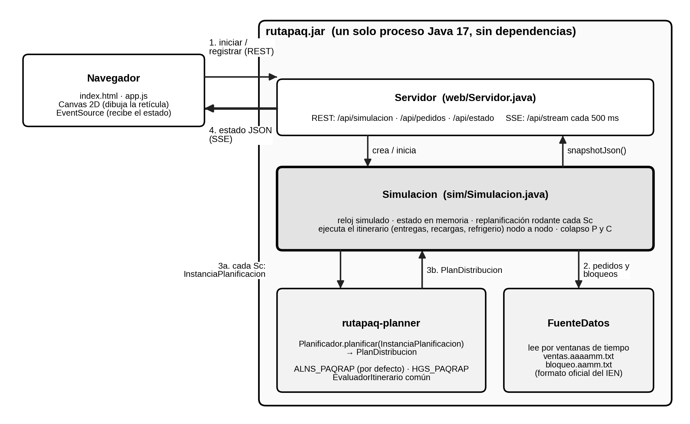

# RUTAPAQ v03: servidor, simulación y visualizador con rutapaq-planner (ALNS y GA)

Un solo proceso Java 17 **sin dependencias en ejecución**. Contiene el código de
**rutapaq-planner v2.0** (`pe.pucp.paqrap.planner`: ALNS_PAQRAP, HGS_PAQRAP, EvaluadorItinerario y
el banco del IEN) y, alrededor de él, la simulación y el visualizador web (`pe.pucp.paqrap.app`).

Alcance de la v03: sobre la **simulación de 5 días** de la v02 se agregan las **averías** de las unidades
(tipos 1, 2 y 3), con registro desde el visualizador, averías programadas por archivo, trasvase de paquetes,
traslado al almacén central y replanificación inmediata. El servidor ya aplica las averías en los tres
escenarios; la operación día a día y la simulación hasta el colapso siguen pendientes en la interfaz.

## Cambios de la v03 respecto de la v02: averías

| # | Cambio | Dónde |
|---|---|---|
| 1 | Registro de averías desde el visualizador: botón **Registrar avería** en el detalle de la unidad y en la pestaña **Averías** del panel derecho. Se elige la unidad y el tipo (1, 2 o 3) y se confirma en un diálogo que muestra cuándo volvería a estar disponible. La avería ocurre en el instante simulado actual. | `resources/web/`, `POST /api/averias` |
| 2 | Al ocurrir, la unidad queda **detenida en su posición exacta** (la calle no se bloquea), sus pedidos vuelven al planificador y se ejecuta un **ciclo de planificación extraordinario** en ese momento (también si la simulación está detenida). | `Simulacion.averiar()` |
| 3 | Reglas de la P&R (pregunta 3): tipo 1 no disponible 2 h en el lugar y con su carga; tipos 2 y 3 permanecen 4 h en el lugar y luego pasan de forma instantánea al almacén central con los paquetes no trasvasados; el tipo 2 vuelve al final del turno siguiente y el tipo 3 tras al menos 2 días, al inicio del turno de 15:00. Todos los valores se configuran (`averia.*`). | `app/sim/ReglasAveria.java`, `app/modelo/Averia.java` |
| 4 | **Trasvase** (tipos 2 y 3): mientras sigue en el lugar, la unidad averiada se entrega al planificador como un depósito temporal (`TipoAlmacen.TRASVASE`) con sus paquetes, una hora de cierre (cuando la llevan al central) y 30 min de atención. Otra unidad puede ir a recoger los paquetes si alcanza a terminar antes del cierre. Con los almacenes del caso el planificador da los mismos resultados que en la v02. | `planner/model/Almacen.java`, `planner/core/EvaluadorItinerario.recargar()`, `DatosPlanificacion` |
| 5 | Averías programadas para los escenarios de 5 días y colapso: archivo mensual `datos/averias.aaaamm.txt` (formato definido por el equipo, ver abajo) y comando `generar-averias` para crear archivos de prueba. `datos/` trae archivos de prueba de ene-2026 a dic-2028 (2 averías por día). | `app/datos/Formato.java`, `FuenteDatos.java`, `GeneradorDatos.java` |
| 6 | Mapa: la unidad averiada se dibuja detenida con un **distintivo rojo con el tipo** (1, 2 o 3) y un halo rojo mientras sigue en el lugar; las que ya están en el almacén central se dibujan junto a su ícono. Al pasar el mouse: tipo, hora de ocurrencia y tiempo de indisponibilidad. Las unidades que hacen un trasvase se ven con un anillo naranja y la parada **T** en su itinerario. | `resources/web/app.js` |
| 7 | Panel derecho con pestañas **Pedidos** y **Averías**: lista de unidades averiadas por tipo (1, 2 y 3) con su fase, tiempo restante y paquetes por trasvasar, e historial de las averías terminadas (duración, pedidos replanificados, trasvasados y devueltos). Al elegir una, el mapa se centra en ella (del panel al mapa). | `resources/web/` |
| 8 | Detalle de la unidad con la avería vigente (ocurrencia, lugar, fin en el lugar, disponibilidad, trasvases, pedidos replanificados) y el periodo de indisponibilidad también en mantenimiento. Avisos emergentes al ocurrir una avería, al trasvasar, al pasar al central y al volver a operar. Panel izquierdo con las averiadas por tipo y resumen final con averías, trasvasados y devueltos. | `resources/web/` |
| 9 | El mantenimiento preventivo convive con las averías: si a las 00:00 empieza el mantenimiento de una unidad averiada que sigue en el lugar, pasa al central con lo no trasvasado y la avería sigue hasta su retorno. | `Simulacion.entrarMantenimiento()` |
| 10 | 17 pruebas nuevas: reglas de cada tipo y límites de turno, formato del archivo, unidad detenida y replanificación, traslado al central y retorno, trasvase en el evaluador, en ALNS, en GA y en la simulación, cierre del trasvase y convivencia con el mantenimiento. | `src/test/java/.../app/sim/AveriasTest.java`, `planner/TrasvaseTest.java` |

Verificación: las 32 pruebas pasan (las 15 del planificador sin cambios y las 17 nuevas). Sin averías, la v03 da los
mismos resultados que la v02 con los mismos datos y semilla (5 días desde el 01/01/2026: 76 pedidos recibidos,
74 entregados, S/ 10 184).

## Cambios de la v02 respecto de la v01

| # | Cambio | Dónde |
|---|---|---|
| 1 | Se leen los archivos del profesor (formato `01d01h30m`). La v01 solo aceptaba el formato sintético `01D01H052` y **descartaba en silencio** todas las líneas oficiales: la simulación corría con 0 pedidos y 0 bloqueos. Ahora se aceptan ambos y las líneas inválidas se informan en consola y en el visualizador. | `app/datos/Formato.java`, `LectorMensual.java`; `planner/ien/LectorVentas.java`, `LectorBloqueos.java` |
| 2 | `datos/` trae los archivos oficiales v20260909 (ventas y bloqueos de ene-2026 a dic-2028) y el plan de mantenimiento preventivo. Se quitaron los archivos sintéticos. | `datos/` |
| 3 | Mantenimiento preventivo: la unidad no recibe rutas que crucen las 00:00 de su día de mantenimiento y ese día queda fuera de servicio en el almacén central. El plan bimensual se repite (setiembre = meses impares, octubre = pares). | `app/datos/PlanMantenimiento.java`, `Simulacion.java` |
| 4 | Códigos de unidad TTNN (TA01, TM01, TB01) según el curso; la v01 usaba A01, M01, B01. | `app/modelo/TipoUnidad.java` |
| 5 | Si el planificador falla en un ciclo, las unidades conservan su itinerario. En la v01 quedaban sin tareas hasta el ciclo siguiente. | `Simulacion.planificar()` y `restaurar()` |
| 6 | % a tiempo corregido: el denominador incluye los pedidos vencidos que aún no se entregan. En la v01 era a tiempo / completados, y un pedido atrasado que nunca llegaba no bajaba el %. | `Simulacion.pctATiempo()` |
| 7 | **Detener** deja la simulación en pausa y **Reanudar** la continúa desde el mismo instante. La v01 la terminaba sin posibilidad de continuar. | `Simulacion.pausar()/reanudar()`, `Servidor` (`/api/simulacion/detener`, `/reanudar`) |
| 8 | La simulación se inicia con fecha **y hora**. | `Servidor.simulacion()`, visualizador |
| 9 | Visualizador nuevo según el prototipo: barra superior con tiempos simulado y real, menú lateral, inventario con semáforo, línea de tiempo D1–D5, rastreo de entregas con buscador, detalle y tooltips de unidades, almacenes, pedidos y bloqueos, resumen al terminar, tema claro y oscuro. Las unidades se desplazan de forma continua siguiendo las calles. | `resources/web/` |
| 10 | Uso del visualizador: cada pedido muestra el ícono y código de la unidad que lo atiende; leyenda del mapa en el panel izquierdo; clic en una unidad (en el mapa o en un pedido) filtra sus pedidos y oculta las demás unidades; clic en un pedido muestra solo la unidad que lo atiende en ese momento. El filtro se quita con la × del buscador, con otro clic en la misma unidad o con Esc. También se filtra escribiendo el código (p. ej. `TA03`) en el buscador. | `resources/web/` |

Verificación: las 15 pruebas del planificador pasan; con los mismos datos y semilla, la v02 da exactamente los
mismos resultados que la v01 (pedidos, entregas, costo); un fallo forzado del planificador deja las
unidades con su plan (v01: 31 de 37 unidades quedaban sin tareas).



## Ejecutar

```bash
mvn package                       # o ./compilar-sin-maven.sh
cp target/rutapaq.jar .
java -jar rutapaq.jar             # http://localhost:8080
```

En el navegador: elegir la fecha y hora de inicio (hay datos de enero 2026 a diciembre 2028) y
**Iniciar**. **Detener** pausa la simulación y **Reanudar** la continúa; **Iniciar** de nuevo descarta la
actual y empieza otra. Los 5 días duran `escenario.semanal.minutosReales` minutos reales (30 por defecto).

Sin interfaz (corre lo más rápido posible e imprime indicadores cada 12 h):

```bash
java -jar rutapaq.jar probar 2026-01-01 120            # 5 días
java -jar rutapaq.jar probar 2027-03-01 240 COLAPSO    # hasta el colapso (o 240 h)
```

Archivos de averías programadas de prueba (v03):

```bash
java -jar rutapaq.jar generar-averias datos 202601 202812 2 7   # meses, averías por día, semilla
```

El banco experimental del IEN sigue funcionando igual desde el mismo jar:

```bash
java -cp rutapaq.jar pe.pucp.paqrap.planner.ien.RunnerIEN --bloques=8
```

## Cómo se usa rutapaq-planner

En cada ciclo (cada `ien.scMinutos` minutos simulados), `Simulacion.planificar()` hace lo mismo que
el `SimuladorColapso` del IEN, pero sobre el estado en vivo:

1. Cada unidad conserva solo la parada hacia la que ya se está moviendo; el resto de su itinerario se libera.
2. Arma la `InstanciaPlanificacion`: un `Vehiculo` por unidad (nodo, hora y carga con que queda libre,
   turno vigente y si ya tomó refrigerio), los `Almacen` con su saldo descontando las recargas
   comprometidas, los `Pedido` con lo que falta asignar (fraccionados con `LectorVentas.fraccionar`
   en partes de `ien.maximoProductosPorEntrega`) y la `MapaReticula` con los bloqueos vigentes.
3. Llama a `Planificador.planificar()` del algoritmo elegido (`planificador.algoritmo=ALNS` o `GA`).
4. Convierte el `PlanDistribucion` en el itinerario de cada unidad: entregas, recargas y refrigerios
   tal como los colocó el `EvaluadorItinerario`.

Entre ciclos, las unidades recorren la **misma** `MapaReticula` nodo a nodo (camino mínimo que no
atraviesa bloqueos) y ejecutan su itinerario. Se aplican las mismas reglas que el planner: el plazo se
cumple con la hora de llegada, cada entrega toma 1 h, el refrigerio dura 1 h, las recargas no toman
tiempo y los intermedios vuelven a 1 000 unidades a las 23:59:59.

Colapso (escenario hasta el colapso, aún no habilitado en la interfaz): **P** cuando un pedido llega a su
límite sin entrega; **C** cuando una ejecución del planificador tarda `ien.saSegundos` o más.

Mantenimiento preventivo (`datos/mant.preventivo.*`): una unidad deja de recibir rutas cuando su
mantenimiento empieza antes de que termine el horizonte de ruta (`planificador.horizonteRutaHoras`, 8 h),
así ninguna ruta cruza las 00:00. Si aun así tuviera paradas a las 00:00, sus entregas vuelven a
planificarse y la unidad pasa al almacén central (traslado instantáneo, supuesto tomado de la regla de
averías tipo 2 y 3). A las 00:00 del día siguiente vuelve a estar disponible en el central.

## Averías (v03)

Reglas según la P&R (pregunta 3) y la Lista de Exigencias v03 (RF05-04, RF05-05, RF05-09, RF07-01, RF08-04):

| Tipo | En el lugar | Luego | Vuelve a estar disponible |
|---|---|---|---|
| 1 · menor | 2 h, con su carga | sigue operando desde allí | a las 2 h |
| 2 · intermedia | 4 h (sus paquetes se pueden trasvasar) | pasa de forma instantánea al almacén central con lo no trasvasado | al final del turno siguiente al de la avería |
| 3 · mayor | 4 h (sus paquetes se pueden trasvasar) | pasa de forma instantánea al almacén central con lo no trasvasado | tras al menos 2 días, al inicio del turno de 15:00 |

Ejemplo: avería tipo 2 de TA03 el 12/01 a las 10:20 (turno de 07:00 a 15:00). TA03 se detiene donde está, sus
pedidos se replanifican en ese momento y el plan puede enviar a otra unidad a recoger sus paquetes (30 min). A las
14:20 pasa al almacén central con lo que no se trasvasó y vuelve a estar disponible a las 23:00, al terminar el
turno de 15:00 a 23:00. Si fuera tipo 1 volvería a las 12:20 en el mismo lugar; si fuera tipo 3, el 14/01 a las 15:00.

Decisiones del equipo donde la P&R aún no precisa:

- El tiempo de trasvase (30 min) sale de la nota de la pregunta 3; el trasvase solo se ofrece en los tipos 2 y 3,
  que son los que la respuesta menciona con "paquetes no trasvasados".
- Tipo 3: "al menos 2 días y retorna en el turno de 15:00 a 23:00" se toma como el primer inicio de ese turno
  cuando ya pasaron 48 h.
- Una avería tipo 1 a mitad de una cuadra: al terminar, la unidad completa la cuadra hasta la esquina y sigue.
- No se puede averiar una unidad que ya está averiada o en mantenimiento.

Registro en línea (lo usa el visualizador): `POST /api/averias?unidad=TA03&tipo=2` responde la avería registrada o
un error (400 datos inválidos, 409 unidad ya averiada, en mantenimiento o sin simulación en curso).
`GET /api/averias` devuelve el historial de averías del escenario.

Averías programadas (5 días y colapso), un archivo por mes en `datos/`: `averias.aaaamm.txt`, registro
`##d##h##m:TTNN,tipo`, por ejemplo `05d10h20m:TA03,2`. El curso aún no publica el formato ni las reglas de
generación ("se tendrán reglas de generación", P&R pregunta 3), así que este formato lo define el equipo y se lee
en `Formato.averia()`; si el curso publica otro, solo cambia ese método. Un registro se omite (y se informa en
consola) si la unidad no existe, ya está averiada o está en mantenimiento en ese instante. Para simular sin
averías programadas: `averia.archivo.habilitado=false`.

## Configuración

| Archivo | Qué contiene |
|---|---|
| `planner.properties` (de rutapaq-planner, sin cambios) | Mapa, almacenes, flota, Sc, Sa, P, parámetros de ALNS y GA |
| `config.properties` | Servidor, algoritmo, escenarios (fecha y hora propuestas, duración del 5D), averías (`averia.tipo1.horas`, `averia.enLugar.horas`, `averia.tipo3.diasMinimos`, `averia.tipo3.horaRetorno`, `averia.trasvase.*`, `averia.archivo.habilitado`), frecuencia de publicación y semáforo (`semaforo.plazo.*`, `semaforo.almacen.*`, `semaforo.carga.*`, `semaforo.pedido.*`) |

Un `config.properties` junto al jar sobrescribe cualquier clave de los dos archivos, sin recompilar.

## Estructura

| Paquete | Qué hace |
|---|---|
| `pe.pucp.paqrap.planner.*` | rutapaq-planner v2.0 (`model`, `core`, `alns`, `hgs`, `ien`); en la v02 solo cambió el formato que aceptan los lectores del IEN; en la v03 se agrega el depósito temporal de trasvase (`TipoAlmacen.TRASVASE`), sin efecto en el banco del IEN |
| `app.sim.Simulacion` | Reloj, estado en memoria, ciclo de planificación con rutapaq-planner, ejecución, averías, colapso |
| `app.sim.ReglasAveria`, `app.modelo.Averia` | v03: reglas de los 3 tipos de avería y registro de cada avería (fases, trasvases, devueltos) |
| `app.sim.Caminos` | Caminos nodo a nodo sobre la `MapaReticula` del planner |
| `app.sim.Planificadores` | Crea `ALNS_PAQRAP` o `HGS_PAQRAP` según la configuración |
| `app.sim.Indicadores` | Semáforo con umbrales configurables |
| `app.datos` | Lectura de ventas, bloqueos y averías programadas línea por línea, y plan de mantenimiento |
| `app.web.Servidor` | REST, SSE y archivos del visualizador |
| `resources/web` | Visualizador (Canvas 2D + EventSource) |

## Desplegar en la VM de AWS (Ubuntu 24.04)

Copiar a la VM `rutapaq.jar`, `config.properties`, `datos/` y `deploy/`, y ejecutar
`./deploy/instalar-en-vm.sh`. Instala Java 17 y Nginx, deja RUTAPAQ como servicio `systemd` en
`127.0.0.1:8080` y lo publica por Nginx en el puerto 80. Para HTTPS con dominio:
`sudo certbot --nginx -d su-dominio`.

## Diferencias con el SimuladorColapso del IEN (declararlas si se comparan resultados)

- El reloj avanza en pasos de 30 s y las unidades se mueven nodo a nodo; en el IEN, cada tramo se
  resuelve de una vez al ejecutar la ventana.
- El colapso P se detecta en el instante en que vence el plazo; en el IEN, al cerrar la ventana Sc.
- La unidad termina la parada hacia la que se mueve antes de recibir el nuevo plan; en el IEN termina
  el tramo en curso al cerrar la ventana.
- El evaluador cuenta el refrigerio antes de la siguiente llegada; aquí la unidad lo toma al llegar al
  nodo de esa parada, antes de atenderla (misma hora de atención).
